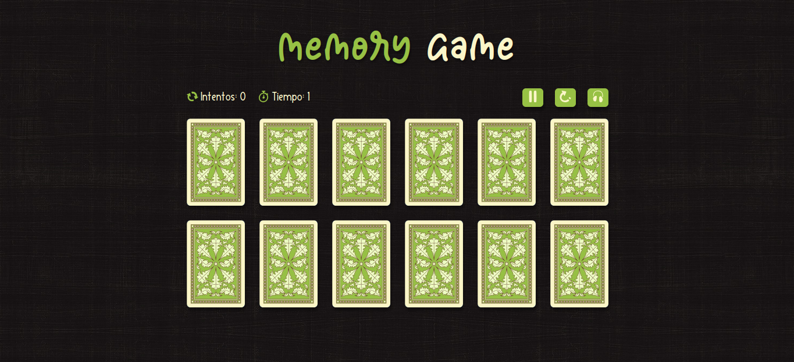
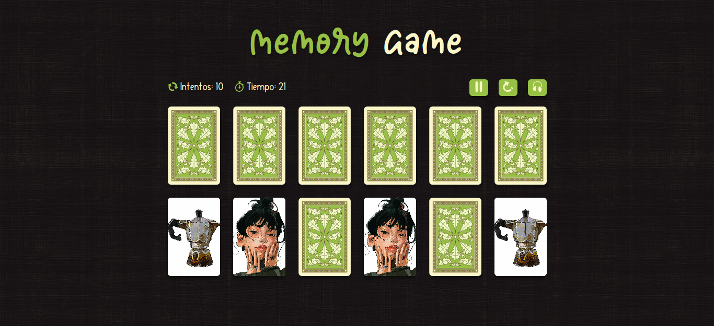

# Memory Card Game — Vanilla JavaScript Architecture

> A framework-free memory card game engineered in pure JavaScript (ES6+), CSS3 and semantic HTML5 — built deliberately to master the fundamentals of the language (direct DOM manipulation, the event loop, framework-less state management and asynchronous events) before scaling to React and React Native.

---

## Preview

<p align="center">
  
</p>

---

## Architectural Intent & Motivation

Modern frameworks abstract away the browser's core primitives. That abstraction is productive, but it can hide *how* rendering, events and state actually work. This project was intentionally built **without frameworks, bundlers or build tooling** so that every interaction is handled explicitly against the native Web Platform APIs.

The goal is to develop a solid mental model of what libraries like React do under the hood — reconciliation, synthetic events, state-driven rendering, effect cleanup — by implementing the equivalent concerns manually.

### Technical challenges addressed

- **Direct DOM manipulation**
  The game board is generated programmatically at runtime: card nodes are created, populated and appended to the DOM from a shuffled data array, instead of being hard-coded in markup. Visual state (flipped, matched, hidden screens) is driven exclusively through `classList` toggling, keeping presentation concerns in CSS and behavior in JavaScript.

- **Event handling & event delegation**
  Card interaction is routed through a single controlled click handler that guards against invalid input (already-flipped cards, matched cards, paused game, evaluation in progress). This mirrors the delegation pattern — one listener per responsibility rather than ad-hoc logic scattered across nodes — reducing listener overhead and keeping the control flow predictable.

- **Centralized, framework-less state management**
  All mutable runtime data lives in a single `gameState` object (`isProcessing`, `isPaused`, `timerId`, `gameEnded`, `attempts`), derived from an immutable `INITIAL_GAME_STATE` template. Resetting the game is a matter of re-spreading the initial state (`{ ...INITIAL_GAME_STATE }`), an approach conceptually equivalent to a reducer's initial state.

- **Timers, the event loop & asynchronous flow**
  `setTimeout` is used to defer the flip-back animation of mismatched pairs, while `setInterval` drives the game clock. Understanding how these callbacks are queued as macrotasks — and how they interact with user input and CSS transitions — is central to avoiding race conditions such as a third card being flipped mid-evaluation.

- **Memory management & resource cleanup**
  Interval IDs are stored in state and explicitly cleared on pause, reset and victory to prevent orphaned timers and leaked closures. Audio resources are released on `beforeunload`, reproducing manually the cleanup responsibility that `useEffect` return functions handle in React.

---

## Features

- **Dynamic shuffle algorithm** — cards are randomized on every game using an unbiased **Fisher–Yates** shuffle, guaranteeing a uniform distribution of layouts.
- **Board locking during evaluation** — an `isProcessing` flag blocks further input while a pair is being compared, preventing race conditions and invalid states.
- **Turn counter** — every attempt is tracked and reported on the in-game HUD and the victory screen, alongside an elapsed-time counter.
- **Responsive layout** — mobile-first grid with progressive breakpoints (`600px`, `900px`, `1200px`) that adapts the board to any screen size.
- **CSS 3D flip animation** — hardware-accelerated card flips built with `perspective`, `transform-style: preserve-3d`, `rotateY()` and `backface-visibility`.
- **Game lifecycle controls** — start, pause/resume, reset and play-again flows, plus a sound toggle for background music and SFX.

---

## Gameplay in Action

<p align="center">
  
</p>

---

## Tech Stack & Mechanics

| Layer         | Technology            | Responsibility & Mechanics                                                                                                                       |
| ------------- | --------------------- | ------------------------------------------------------------------------------------------------------------------------------------------------ |
| **Logic**     | Vanilla JS (ES6+)     | Fisher–Yates shuffling, centralized state object, input guarding, pair evaluation, timers (`setTimeout` / `setInterval`), lifecycle and cleanup. |
| **Styling**   | Modern CSS3           | 3D transforms, transitions, Flexbox/Grid layout, media-query breakpoints, custom fonts and state-driven utility classes.                         |
| **Structure** | Semantic HTML5        | Accessible document skeleton, native `<button>` controls, HUD, victory and pause overlays, with the board injected dynamically at runtime.       |

> [!NOTE]
> The only third-party asset is [Howler.js](https://howlerjs.com/), loaded via CDN purely as an audio playback layer. All game logic, rendering and state management are implemented in plain JavaScript.

---

## Project Structure

```text
Memory-Game/
├── index.html
├── assets/
│   ├── gameplay-overview.png
│   └── game-matched.png
├── css/
│   └── styles.css
└── js/
    └── app.js
```

---

## Getting Started

### Prerequisites

- Any modern browser (Chrome, Firefox, Edge, Safari).
- *(Optional)* [Node.js](https://nodejs.org/) to serve the project locally with `npx`.

### 1. Clone the repository

```bash
git clone https://github.com/JosmarV/Memory-Game.git
cd Memory-Game
```

### 2. Run the game

**Option A — Open directly in the browser**

Open `index.html` by double-clicking it, or from the terminal:

```bash
xdg-open index.html   # Linux
open index.html       # macOS
start index.html      # Windows
```

**Option B — Serve it locally (recommended)**

```bash
npx serve .
```

Then navigate to the local URL printed in the terminal (by default `http://localhost:3000`).

---

## Author

**Josmar Veliz** — Systems Engineer & Software Developer

- GitHub: [github.com/JosmarV](https://github.com/JosmarV)
- LinkedIn: [linkedin.com/in/josmarveliz](https://www.linkedin.com/in/josmarveliz)
